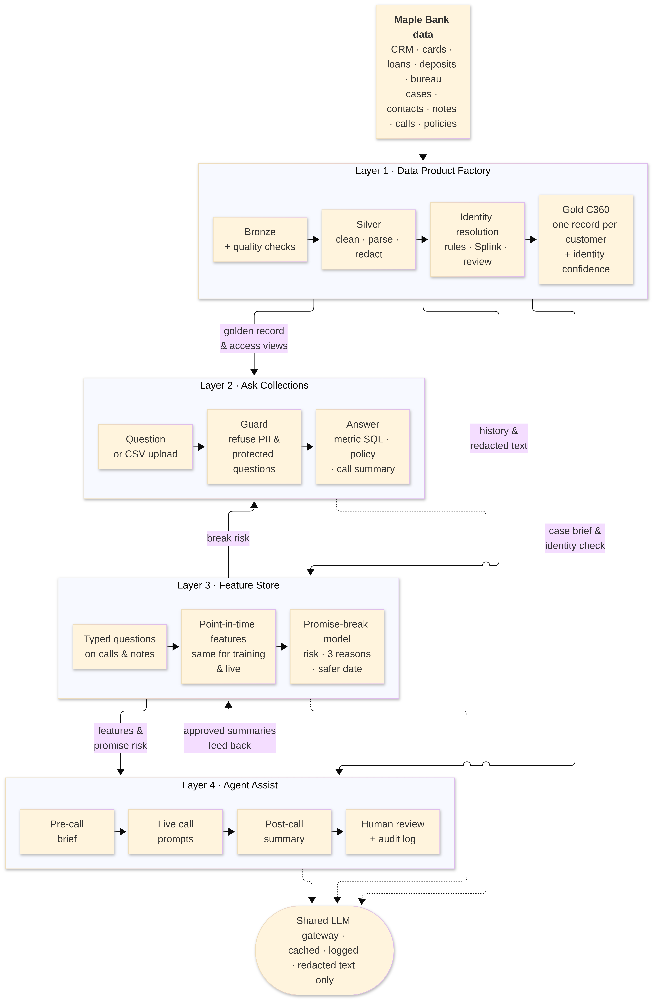

# dhandho.exe: Two-Speed AI for Collections

An end-to-end AI system for a bank's collections team. We built it for the **CIBC Collections Hackathon** on
Maple Bank, a fully synthetic dataset with 1,000,000 customers, 31 source tables, 25,000 call transcripts, policy
documents and human-labelled calls and notes.

The system has four layers:

- **Collections 360:** one trusted record per customer, matched across five source systems, with an identity
  confidence on every customer.
- **Ask Collections:** plain-English questions answered with the SQL or the cited documents shown, and refusals of
  anything that would touch protected attributes.
- **Feature store:** features built from structured data and from calls and notes, with one definition used for both
  training and live scoring.
- **Agent Assist:** briefs the agent before a call, flags hardship and risky promises live during it, and drafts a
  summary the agent approves afterwards.

**Two-Speed AI** is the design idea. Fast, typed decisions make the decisions: each one has a probability, an
evidence quote and a plain-English reason. Large language models only write text. A person approves anything that
affects a customer.



## Results

| Area | Result |
|---|---|
| Identity resolution | 3,487,885 source records → **1,060,086 golden customer IDs**. Precision **99.8%** and recall 97.7–98.9% per source, measured on the collections-case truth set; 0 of 1,079 joint holders and co-borrowers wrongly merged |
| Data quality | **86 automated checks** per run, 0 blocking; 30 data issues documented with record counts, 26 of them not in the bank's own incident list |
| Privacy | 760,594 agent notes and 388,701 transcript turns redacted (Microsoft Presidio); spot check finds no identifier left |
| Ask Collections benchmark | **21/21** on the dev questions with gold answers; 50 questions answered by running the system (35 released + 15 extra), 9 correct refusals |
| Notes retrieval (RAG) | Hybrid BM25 + embeddings: a note of the right type in the top 3 for **95.4%** of questions, 97.2% on French-only notes |
| Feature store | 30 point-in-time features (19 SQL, 11 from text); 318,808 text-feature rows; training and live scoring tested to give identical values |
| Promise-break model | LightGBM on 198,119 resolved promises, time-ordered split: **AUC 0.775**; the highest-risk decile breaks 96.3% of the time (60% overall) |
| Live call assist | Keyword rules on 500 labelled calls: hardship flagged in 60% of hardship calls (156 of 262), **0 false alarms** on the 238 calls without hardship; promise heard in 85% |
| Post-call summary | 97% template fidelity; with the model, 67% exact match to the gold summary sentence on 30 calls |
| Governance | 0 of 100 decisions changed when names and gendered words were swapped; 10 of 10 protected or proxy questions refused; no protected or PII column in any output schema; model scores within 2.4 points across protected groups |

Every number comes from a report the system writes: see [`outputs/`](outputs/) and [`deliverables/`](deliverables/).

## What each layer does

### 1. Data Product Factory: the Collections 360

Five source systems (CRM, cards, loans, deposits, credit bureau) store the same people differently. The layer turns
them into one record per customer, `gold.c360_customer`. Merging two different people could disclose one person's
debt to another, so the design is **precision-first**: link only on strong evidence, send doubtful pairs to a
person, and make the agent verify identity whenever confidence is not high.

The layer is built in five stages:

1. **Bronze:** every file is stored exactly as received, with checksums checked against the release manifest.
2. **Silver:** each source has its own parser (DuckDB macros in dbt). Values that fail to parse go to a quarantine
   table with a reason. Free text is redacted with Presidio before anything else reads it.
3. **Identity:**
   - deterministic rules come first, such as a shared national ID or a deposit number that equals the bureau
     reference;
   - then **Splink**, a probabilistic record-linkage model trained without labels;
   - then hard constraints: never auto-link differing dates of birth, joint holders, Jr/Sr or twins;
   - finally, clustering into stable golden IDs, with a crosswalk and history. Grey-zone pairs go to a review app.
4. **Gold:**
   - survivorship picks each field: the most recent contact details, the most restrictive consent when confidence is
     not high, and any restriction from any merged record;
   - accounts, cases, contacts, promises and incident effects are added alongside;
   - lineage columns go on every row;
   - role-based views serve agents (masked) and analysts (no direct identifiers).
5. **Quality:** six families of checks run on every build, and known incidents are labelled instead of raising false
   alarms.

Several deliberate data traps are fixed once, in gold, as new columns, and the source values are kept:
- a renamed column;
- an app outage that posted payments late;
- DPD buckets that disagree with DPD;
- quarter-end dates in mixed formats.

[`layer1/docs/decisions.md`](layer1/docs/decisions.md) records 45 places where the real data contradicted the design,
with the evidence for each. Orchestration uses Dagster, and the whole build runs in about 16 minutes on a laptop.

### 2. Insight and NLP: Ask Collections

A question goes through these steps:
- **typo fix;**
- **parsing:** IDs and time periods, resolved against the data's snapshot date;
- **guard:** refuses protected attributes, proxies such as postal area or language, bulk personal-data export, and
  off-topic questions;
- **router:** picks one of four lanes.

The four lanes:

- **Metric SQL:** a semantic layer built from the bank's 15 certified metric definitions, plus rule-built aggregates
  (average, median, share, top N, changes between periods). A coverage check lists anything the rule plan leaves out.
  An LLM then extends or writes the SQL, which always passes a **SQL guard**:
  - a single SELECT;
  - safe views only;
  - no personal or protected columns;
  - a row limit.

  Uncertified answers are labelled as such.
- **Policy:** answers from the bank's documents, where the newest official version wins (policy > procedure > FAQ >
  script). Code checks every citation.
- **Notes (RAG):** BM25 plus `multilingual-e5-small` embeddings over one case's redacted notes, in English and French.
  Vectors are stored in DuckDB. The model writes an answer and cites note IDs.
- **Call summaries:** typed facts are taken from the most recent call and written as one sentence in the gold style.

RAG was also tested on call transcripts. Rules matched the gold sentence in 90% of calls against 60% for RAG, so the
rules were kept. Hidden holdout question sets, written without seeing the rules, guard against overfitting to the
benchmark.

### 3. Feature Store

- **Typed questions** on calls and notes are versioned in [`layer3/text/questions.yaml`](layer3/text/questions.yaml):
  hardship, hardship reason, promise amount, date and intent, dispute, complaint, cease request, insolvency,
  sentiment and next step. They are answered by an LLM with structured output, or by auditable keyword rules offline.
  Every answer records its prompt version and model version.
- **Point-in-time features:** `get_features(customer, as_of)` and `build_training_frame(events)` run the same SQL,
  using only data known at `as_of`. Tests prove that training and live scoring give identical values.
- **Feature registry:** records each feature's definition, source, refresh, sensitivity, whether it is AI-derived,
  and its accuracy measured against the human labels.
- **Promise-break model:** LightGBM with three plain-English reasons per score, from SHAP, and a safer payment date
  (the day after the usual salary credit). Hardship-related features are deliberately excluded, so they can never
  raise a customer's risk.

### 4. Agent Assist + Post-call Summary (the use case built in depth)

- **Pre-call brief:**
  - red flags with their policy citations;
  - hardship options from the programme rules, not from an LLM;
  - promise-break risk with its reasons;
  - past approved summaries.
  An **identity gate** hides the debt until the agent verifies a customer whose match confidence is not high.
- **Live call replay:**
  - each turn of a real transcript goes through the extractor;
  - prompts appear with the customer's words that triggered them, the rule and the policy;
  - a spoken promise is parsed, scored and given a safer date;
  - a QA checklist ticks as required statements are made.
- **Post-call summary:** a draft with a gold-style narrative. The agent edits it (a reason is required), approves or
  rejects it. Approved summaries flow back into the feature store and the next brief.
- **Human review:** confidence gates decide what is shown as a suggestion and what needs confirmation. Hardship
  always needs confirmation, and anything below the threshold goes to a review queue. Overrides need a reason, and
  every action lands in an append-only audit log. Nothing is sent to a customer automatically.
- **Governance report:**
  - a counterfactual name and gender swap;
  - a scan of every output schema for protected or PII columns;
  - refusal checks;
  - model fairness by group, measured only in a restricted schema.

### Shared foundation

- **LLM gateway** [`shared/llm.py`](shared/llm.py): every model call goes through one function. It caches on disk
  (the same input gives the same answer, and reruns are free), logs tokens and latency, and works with Anthropic,
  Groq, Cerebras, Ollama or any OpenAI-compatible API.
- **Typed decisions** [`shared/decide.py`](shared/decide.py): yes/no, choice, score or extract, each returning an
  answer, a probability and an evidence quote. A quote that is not found in the text caps the probability.
- **Audit log** [`shared/audit.py`](shared/audit.py): append-only, and it rejects events that carry PII or protected
  attributes.
- **App** [`app/`](app/): one Streamlit app with five pages: Collections 360, Ask Collections, Feature Store, Agent
  Assist, and Review and Governance.

## Responsible AI

- **No protected attributes in decisions.** Gender, marital status, citizenship, household, newcomer status,
  accessibility, vulnerability, accent, age and AML fields live only in a `restricted` schema, used for fairness
  measurement. Proxies (postal area, preferred language) are kept out of features too. Ask Collections refuses
  questions about them.
- **Only redacted text reaches a model**, never customer tables.
- **Every decision has a reason** an agent can read, and **a person can override it**.
- **Hardship is protective only.** It unlocks help options but never raises a risk score. Disability is described as
  "health-related hardship".

## Tech stack

Python 3.11 · DuckDB · dbt-duckdb · Dagster · Splink · Microsoft Presidio + spaCy · LightGBM · sentence embeddings
(`intfloat/multilingual-e5-small`) · sqlglot · Streamlit · LLMs through one gateway (Groq `gpt-oss-20b`/`120b` on the
free plan; Anthropic and others supported) · pytest (about 590 tests)

## How to run it

You need:
- Python 3.11 (installed by [uv](https://docs.astral.sh/uv/));
- about 25 GB of free disk and 6 GB of free RAM;
- no GPU.

No API key is needed either: without one, every part runs on its offline rules. Run the commands from the repository
root.

**1. Environment**

```bash
pip install --user uv
uv sync --all-groups
uv pip install en_core_web_md@https://github.com/explosion/spacy-models/releases/download/en_core_web_md-3.8.0/en_core_web_md-3.8.0-py3-none-any.whl
cp .env.example .env
```

Optional: to switch on the AI parts, put a free Groq key in `.env`. Set `LLM_PROVIDER=groq`, `GROQ_API_KEY=gsk_...`
and `LLM_OFFLINE=0`, then check it with `uv run python -m shared.llm`.

**2. Data** (the synthetic dataset published for the hackathon; it is not in this repository)

```bash
pip install -U huggingface_hub
hf download nuxsh/maple-collections-hackathon maple_collections_release.zip --repo-type dataset --local-dir data/maple_data
unzip -n data/maple_data/maple_collections_release.zip -d data/raw/
```

**3. Build** (about 25 minutes; `--target dev` builds a 50K-customer sample in about 3 minutes)

```bash
uv run python -m layer1.build --target full                 # raw tables -> golden C360, redaction, data quality
uv run python -m layer1.build --verify-only --target full   # ends with "Layer 1 is ready"
uv run python -m layer3.build --extractor rules             # history tables, text features, feature registry
uv run python -m layer2.build                               # Ask Collections' safe views
```

**4. App**

```bash
uv run streamlit run app/Home.py      # http://localhost:8501
```

The demo path:
1. **Agent Assist → Demo case** to open the case.
2. **1 · Brief**: red flags, hardship options and promise risk.
3. **2 · Call**: press *Next turn*. Hardship is flagged on the turn it is said, and the $400 promise is checked.
4. **3 · Summary**: approve the draft.
5. **Review and Governance**: the review queue and the audit trail.

DuckDB allows one writer, so close the app before any build step.

**5. Tests and benchmark**

```bash
uv run pytest                                          # tests never call a real LLM; some need the data (step 2) and the build (step 3)
bash submission/run_benchmark.sh --no-model            # regenerate the benchmark answers, rules only
uv run python -m layer2.benchmark.eval_dev --from-csv submission/benchmark_answers.csv
```

## Repository map

| Path | What is there |
|---|---|
| [`layer1/`](layer1/), [`dbt/`](dbt/), [`orchestration/`](orchestration/) | Data Product Factory: ingest, parsers, identity resolution, gold C360, data quality, redaction, review app, Dagster graph |
| [`layer2/`](layer2/) | Ask Collections: parsing, routing, refusals, semantic layer, SQL guard, policy answers, notes RAG, call summaries, benchmark tooling |
| [`layer3/`](layer3/) | Feature store: typed questions, extractor, point-in-time features, registry, label evaluation |
| [`layer4/`](layer4/) | Agent Assist: pre-call brief, live replay, post-call summary, review queue, governance; `models/promise_break/` |
| [`shared/`](shared/) | LLM gateway, typed decisions, DB connection, audit log |
| [`app/`](app/) | The Streamlit app |
| [`deliverables/`](deliverables/) | Architecture diagram, data contract for the C360, data-quality report |
| [`outputs/`](outputs/) | Evaluation reports produced by the system |
| [`submission/`](submission/) | Benchmark answers and the scripts that regenerate and check them |
| [`docs/`](docs/) | Interfaces between layers, team plan, hand-over notes, data dictionary |

Each layer folder has its own `README.md`, `CHANGELOG.md` and `tests/`. The detailed design notes are in
[`layer1/docs/`](layer1/docs/), [`layer2/docs/`](layer2/docs/) and [`layer3/STATUS.md`](layer3/STATUS.md).

## AI tools used to build it

Claude Code helped write code, tests and documents across the project. The team checked the results with the test
suite and against the public labels.

## Team and contributions

Built by a team of four in 36 hours during the build phase of the CIBC Collections Hackathon (3–4 Oct 2026). The
system was designed together. Each person's main contributions:

**Anish Toshniwal: Data Product Factory, and the feature store on full data**
- Built Layer 1 end to end:
  - bronze ingest and per-source silver parsers;
  - identity resolution (deterministic rules, Splink, constraints, clustering, crosswalk, threshold tuning, review
    workflow);
  - gold C360 dbt models with contract tests;
  - 86 data-quality checks;
  - Presidio redaction of notes and transcripts;
  - fairness audit, role-based access views, and sensitivity tags and mappings;
  - Dagster orchestration and the one-command build.
- Wrote the data contract, the data-quality report and the Collections 360 page.
- Completed Layer 3 on full data: the history tables, the build command, label-aligned typed questions, the label
  evaluation and batch text features. Trained the promise-break model on full data.
- Ran the final benchmark on the extra questions, with rule fixes; made the architecture diagram.

**Het Selarka: Ask Collections (Insight and NLP)**
- Built Layer 2 end to end:
  - parsing, routing and refusals;
  - the semantic layer over the certified metrics and the rule-built aggregates;
  - the coverage check, AI-extended SQL behind the SQL guard, and LLM guardrails;
  - policy answers with checked citations;
  - call-summary rules;
  - notes RAG (BM25 + e5 embeddings) and the transcript RAG experiment;
  - the typo fixer and the query checker.
- Built the benchmark runner, the dev scorer and the hidden holdout sets.
- Built the Ask Collections page; also did the app's visual design and the live "Suggestions" coach in Agent Assist.

**Madhur Kankane: team lead, shared foundation and Agent Assist**
- Built the shared code: the LLM gateway with cache, call log and free providers, typed decisions, the DB
  connection and the audit log.
- Built the app shell.
- Built Layer 4:
  - the pre-call brief with the identity gate;
  - the live call replay with policy-cited prompts, the promise check and the QA checklist;
  - the post-call summary with approval and write-back;
  - the review queue and confidence gates;
  - the governance checks and report, and the replay and summary evaluations.
- Fixed leakage in the promise model's features.
- Led integration, interfaces and planning.

**Ayush Kanani: Feature Store design**
- Built the first version of Layer 3:
  - versioned typed text extraction;
  - point-in-time feature definitions and evaluation;
  - promise-break model training and explanation code;
  - the Feature Store page, Layer 3's status notes and its architecture review.

Data: the Maple Bank dataset is fully synthetic, provided by the hackathon organisers. No real customer data is used.
